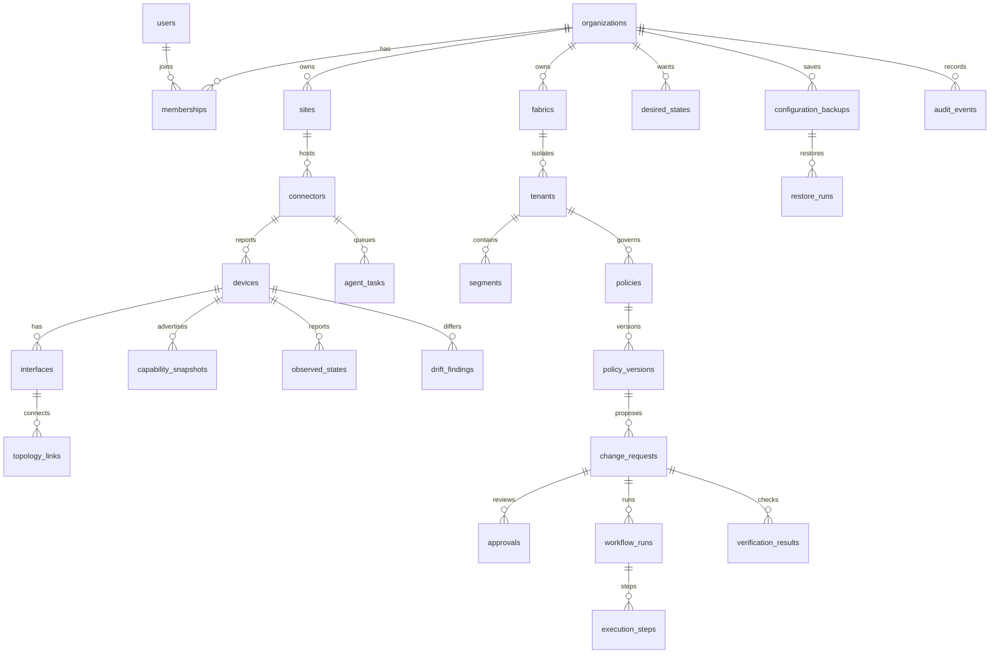

# Schema

Source of truth: `internal/migrate/sql/001_schema.sql`, `002_rls.sql`, and `003_author_confirmation.sql`.

Organization is the owner of every tenant table. A fabric tenant is a network isolation domain and has its own `organization_id`. Composite unique keys `(organization_id, id)` back composite foreign keys so a row cannot point at another organization's parent.

Lifecycle for sites, devices, fabrics, tenants, and segments is `active`, then `disabled`, then `archived`. Archived rows stay for audit and are not execution targets.

Change status moves `validated` to `approved`, `rejected`, or `cancelled`; `approved` to `queued`; `queued` to `applying`; `applying` to `verifying`, `partial`, `failed`, `unknown`, or `cancelled`; `verifying` to `succeeded`, `failed`, or `unknown`; `partial` to `compensating`; `compensating` to `compensated` or `rollback_failed`. An `unknown` outcome is retried by inspecting the simulator ACL record before writing again.

`author_confirmed` is separate from approval. The worker claims a change only after the author confirms the plan hash. Recovery of `applying`, `verifying`, `partial`, `compensating`, and `unknown` keeps the stored policy version and the stored device list. A newer policy version or a device discovered later does not rewrite that plan. Completed and skipped rollback steps are not repeated. A `compensation_failed` step is left in place, with its ACL, and the change stays `rollback_failed` for an operator to review. A second run does not clear that failure.

Retention is `organizations.retention_days` (30 to 3650, default 365). `POST /api/v1/maintenance/retention` deletes aged audit events and observed snapshots, and deletes aged configuration backups except the newest five and any backup referenced by a restore.

Indexes follow the access paths used by the API: organization plus lifecycle or status, device lookup, and time-ordered audit, drift, and backups. `execution_steps` is unique on `(change_request_id, operation_key)` so a retry does not insert a second step. `idempotency_keys` stores the change-create response for a repeated `Idempotency-Key`.
